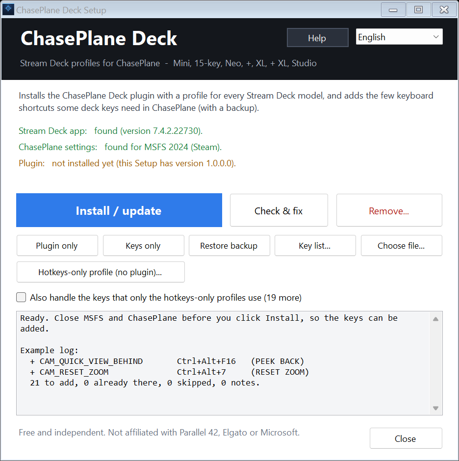

# ChasePlane Deck for Stream Deck

A free, unofficial Stream Deck plugin with a ready-made profile for **every Stream Deck model** (Mini, 15-key / MK.2, Neo, +, XL, + XL, Studio) to control **ChasePlane** (Parallel 42) in Microsoft Flight Simulator 2020 and 2024.

- Cockpit / External / World camera keys, **the views of your loaded aircraft on the keys (live names, the active view lights up)**, cinematic, flashlight, nearest tower / runway / parking / spotting, drone, flyby, traffic.
- Fly cam, look, roll, zoom, peek, night vision, binoculars, depth of field, exposure, head tracking.
- Pages (tabs) instead of one crowded screen. Small decks (Mini, Neo, +) get a "next page" key.
- **Dials** on the Stream Deck +, + XL and Studio: zoom, look left / right, look up / down, next / previous view, roll and night vision, with what you just did shown on the touch strip.


## Download

**[ChasePlane-Deck-Setup.exe](https://github.com/kekev2001/chaseplane-deck/releases/latest/download/ChasePlane-Deck-Setup.exe)** (about 13 MB, Windows 10/11; current version: [latest release](https://github.com/kekev2001/chaseplane-deck/releases/latest), older versions are on the [Releases page](https://github.com/kekev2001/chaseplane-deck/releases)). Everything is inside this one file: the plugin, a profile for every Stream Deck model, the hotkeys-only fallback profiles, the key list and a help window in English and Dutch. SHA-256: see [download/SHA256.txt](download/SHA256.txt). Dutch readme: [README-NL.md](README-NL.md).



## Install (2 minutes)

1. Install the **Stream Deck app** (version 6.4 or newer) and connect your deck.
2. Run **`ChasePlane-Deck-Setup.exe`** (English or Dutch: it follows your Windows language, and the box at the top right switches it) and click **Install / update**.
   - Windows may say *"Windows protected your PC"* because the program is not code-signed. Click *More info* > *Run anyway*.
   - The Stream Deck app shows an install window for the plugin. Click *Install* there.
   - Close MSFS and ChasePlane first if you want Setup to add the extra key shortcuts (see below).
3. In the Stream Deck app pick the **ChasePlane** profile for your deck.
4. Start MSFS and ChasePlane. The status key turns green when the plugin is connected.

## Update, fix, remove

- **Update:** download the new exe, run the new `ChasePlane-Deck-Setup.exe` and click *Install / update*. Setup shows which plugin version is installed and which one it carries; keys that are already set are not added twice. If the author built an update address into Setup, it tells you when a newer version exists (a link only; nothing is downloaded or run automatically).
- **Check & fix:** checks the Stream Deck app, whether the plugin is installed and intact, whether all keys are set in ChasePlane, whether the ChasePlane Bridge answers, and what the plugin log last complained about. Whatever Setup can fix itself (reinstall the plugin, add missing keys) it does after you confirm.
- **Remove...:** you choose what goes: the keys Setup added to ChasePlane (only those exact shortcuts, with a backup), the plugin, and the ChasePlane profiles in the Stream Deck app (moved to a backup folder next to ProfilesV3, not deleted). Tick *Install again afterwards* for a clean reinstall. The Stream Deck app is closed and started again for that.
- **Restore backup...:** if shortcuts of yours are gone from ChasePlane, pick one of the saved copies (the one with the most shortcuts ChasePlane lacks now is pre-selected). *Only my shortcuts* brings your shortcut list back and leaves every other setting as it is now; Setup then adds its deck keys again without touching yours. *The whole settings file* puts `user_settings.json` back as it was in that copy. The file as it is now is saved first. Setup works only on a ChasePlane that has saved its own shortcut list; if that list is still empty it changes nothing.

## The extra ChasePlane keys

Views, cameras, cinematic, flashlight, the nearest tower / runway / parking / spotting, drone, flyby, traffic and the three speeds talk to ChasePlane directly through its Bridge and need nothing. The other keys (move, look, zoom, peek, roll, binoculars, night vision, exposure, depth of field, head tracking, ...) press **the keyboard shortcut you have set for that command in ChasePlane**. The plugin reads your shortcuts from ChasePlane while it runs, so if you changed them, or other people have other ones, the deck follows. Only a command that has no shortcut yet needs one. Setup can add those (a `Ctrl+Alt` combination) to ChasePlane's `user_settings.json`:

- *Install / update* asks first and tells you how many it would add; answer **No** (or use *Plugin only*) and ChasePlane's settings stay completely untouched,
- a backup is saved next to the file first, plus a second copy in `%APPDATA%\ChasePlane Deck\Backups` (outside ChasePlane's folder); after writing, Setup reads the file back and puts the original back if it is not exactly as intended,
- a command that already has a key is left alone; if the combination Setup wants is used by another command, it picks a free one (`Ctrl+Alt+Shift+...`) instead, because the deck reads whichever key it is,
- *Key list...* shows every command so you can assign them by hand in ChasePlane > Preferences > Control Assignments instead,
- if you use ChasePlane cloud sync, ChasePlane may bring back its cloud copy of the settings; assign the keys by hand then.

A deck key whose command has no shortcut (or whose shortcut is a mouse button) flashes when you press it, and the plugin log says which command it was. The plugin presses keys only while the flight simulator window is in front, never into another window. It does that with a small helper, `keysend.exe`, in the plugin folder.

The *Hotkeys-only* profiles are different: their keys send fixed shortcuts (the `Ctrl+Alt` ones above and ChasePlane's defaults), so those need the exact shortcuts of the key list.

## Make your own keys

In the Stream Deck app, open the action list, find **ChasePlane** and drag **ChasePlane command** onto any key (also in your own profiles). Under the key you choose the command from a list of everything ChasePlane can do. The list comes from ChasePlane itself while it runs (otherwise you get the built-in list) and shows the shortcut you have set for each command. Pick *Hold* (the shortcut stays pressed while you hold the key: move, look, boost) or *Tap* (a quick press), and optionally show the command's name on the key. The key then presses your own shortcut; a command without a shortcut flashes and the settings say so.

## The dials (Stream Deck +, + XL, Studio)

The ChasePlane profiles of these decks come with the dials already set, on every page:

| Dial | Turn right / left | Push |
|---|---|---|
| ZOOM | zoom in / out | reset zoom |
| LOOK | look right / left | reset horizon |
| LOOK UP/DOWN | look up / down | reset horizon |
| VIEW | next / previous view | inside / outside |
| ROLL (+ XL) | roll right / left | reset horizon |
| NIGHT VISION (+ XL) | more / less intensity | night vision on / off |

The Stream Deck + has the first four, the + XL all six, and the Studio ZOOM and VIEW. Turning a dial presses the shortcut you have set in ChasePlane for that command (the same shortcuts as the keys, and only while the flight simulator window is in front); the touch strip shows the dial's name and, for a moment, what it just did. Tapping the touch strip does the same as pushing the dial.

To change a dial, or to put one on a dial of your own profile: drag **ChasePlane dial** (group ChasePlane) onto a dial in the Stream Deck app and choose the command for *turn right*, *turn left*, *push* and *tap the touch strip* (optionally another command for turning while pushed in), plus a name for the touch strip. *How long the shortcut stays down per turn* sets the feel: *Short* is one quick press per click (steps, views), *Medium* and *Long* keep the shortcut down while you keep turning, so the camera moves smoothly. The *Hotkeys-only* profiles do not use the dials.

## Which profile do I get

| Deck | Keys | Pages |
|---|---|---|
| Stream Deck Mini | 6 | 8 (last key = next page) |
| Stream Deck 15 keys / MK.2 | 15 | 5 tabs |
| Stream Deck Neo, Stream Deck + | 8 | 8 (last key = next page) |
| Stream Deck XL | 32 | 4 tabs + 4 always-there keys |
| Stream Deck + XL | 36 | like XL plus one extra column |
| Stream Deck Studio | 32 | like XL on two long rows |

The *Hotkeys-only profile...* button in Setup imports the same profile without the plugin (every key sends a keyboard shortcut; no live view names). Those profiles are inside the exe; no loose files are needed.

## Problems

- **Status key stays red / "BRIDGE OFFLINE"**: start MSFS and ChasePlane; the plugin reconnects by itself within seconds.
- **A key flashes and does nothing**: the command has no keyboard shortcut in ChasePlane (assign one in Control Assignments or let Setup add it), or the flight simulator window is not in front.
- **Keys do nothing**: if MSFS/ChasePlane runs as administrator, run the Stream Deck app as administrator too.
- **Plugin log**: `%APPDATA%\Elgato\StreamDeck\Plugins\com.chaseplanexl.deck.sdPlugin\logs\plugin.log`
- **A tab opens the wrong page**: please report it with your deck model.
- **Remove**: delete the plugin in the Stream Deck app (More actions > Plugins) and use *Undo keys* in Setup.

## Please note

- The plugin was tested against a simulated ChasePlane Bridge and a simulated Stream Deck, and the profile files were checked structurally. Reading the key list, the speed keys and pressing a key (the in/out camera switch, with the user's own shortcut) were also checked against a running ChasePlane. Reports from real decks (especially Mini, Neo, +, + XL and Studio) are very welcome. The dials were built from Elgato's documentation and checked with a simulated Stream Deck; they have not been tried on a real Stream Deck + yet, so please tell me how they feel (and whether the touch strip text looks right).
- The plugin uses ChasePlane's local Bridge (`ws://127.0.0.1:8652`). That interface is not officially documented, so a ChasePlane update can change it. The `hotkeys-only` profiles are the fallback.
- Independent project. Not affiliated with, endorsed by or supported by Parallel 42, Elgato or Microsoft. ChasePlane, Stream Deck and Microsoft Flight Simulator are trademarks of their owners.
- Setup does not install anything outside the Stream Deck plugin folder (via the Stream Deck app; that folder includes the small key helper `keysend.exe`), a temporary file in `%TEMP%\ChasePlaneDeckSetup`, copies of ChasePlane's `user_settings.json` in `%APPDATA%\ChasePlane Deck\Backups`, and the backup/edit of ChasePlane's `user_settings.json` that you approve by clicking Install. Without a built-in update address it does not use the network at all; with one, it only requests that one small file when it starts.

## Building from source (Windows)

Needs Windows PowerShell 5.1 and the .NET Framework 4 compiler that ships with Windows (`csc.exe`); nothing is downloaded.

```powershell
powershell -ExecutionPolicy Bypass -File build\Build-ChasePlaneXL.ps1      # plugin package, profiles, key list
powershell -ExecutionPolicy Bypass -File build\Build-Installer.ps1         # release\ChasePlane-Deck-Setup.exe
```

Tests: `test\Validate-Profiles.ps1` (structure of all profiles), `test\Test-Installer.ps1` (the installer, on scratch copies only) and `test\plugin-test.js` (the plugin against a fake Bridge; needs `npm install ws` in `test`).

**Releasing an update:** raise the number in `VERSION`, run both build scripts, then `build\Build-Installer.ps1 -UpdateUrl https://raw.githubusercontent.com/kekev2001/chaseplane-deck/main/latest.json -DownloadUrl https://github.com/kekev2001/chaseplane-deck/releases/latest -Notes "what is new" -Publish`, commit `download\` and `latest.json`, push, and create a GitHub release (tag `vX.Y.Z`, attach `release\ChasePlane-Deck-Setup.exe`). Copies of Setup that were built with that address then show an "Update available" link. Developer notes in Dutch: [docs/ONTWIKKELEN.md](docs/ONTWIKKELEN.md).

## License

[MIT](LICENSE). Unofficial; not affiliated with Parallel 42, Elgato or Microsoft.